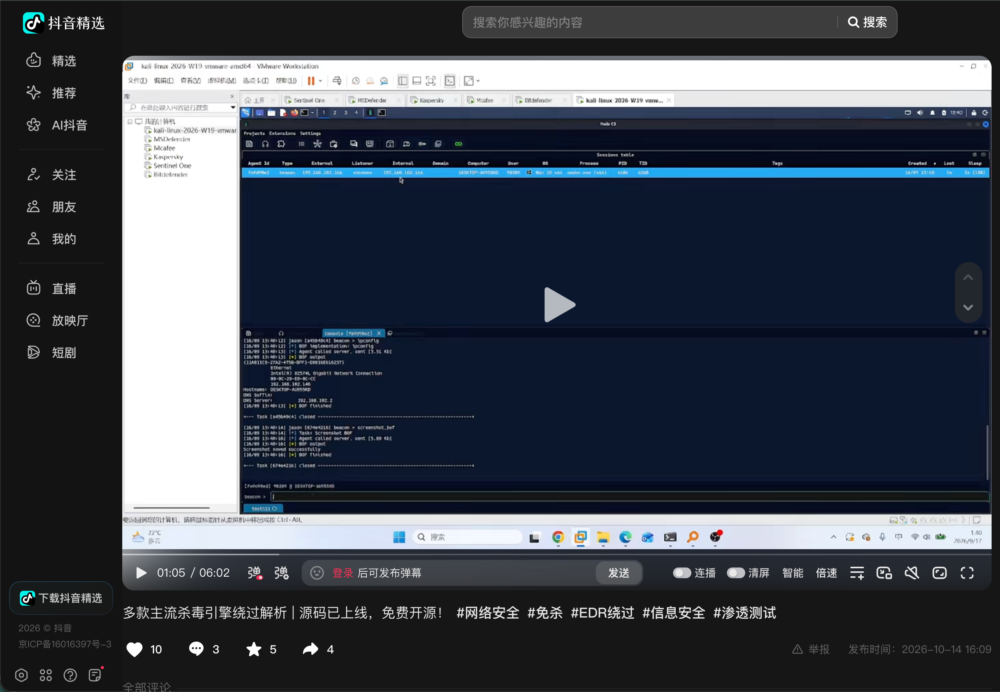
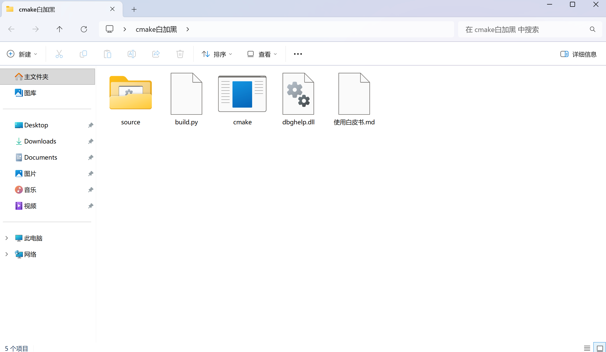

# 挑战主流杀软之后，我们选择开源

> 信益安信息安全研究院

各位师傅们，好久不见。

这段时间团队集中在攻防项目上，公众号更新慢了，让各位久等。项目告一段落，这次直接为大家公开一套完整的白加黑实现技术，并附上多杀软对照实测视频。

---

## 白加黑关键实现

白加黑的原理并不新鲜：用带签名的白 EXE，加载同目录下的 DLL。真正要解决的，是加载链在主流杀软的检测下能否完成上线，并在定时扫描后仍保持会话。

这次我们为大家开源一套完整的白加黑实现：带签名的白宿主 **cmake.exe**（Kitware 原版，未改动），以及自研代理加载器 **dbghelp.dll**。两个文件放到同一目录，运行 **cmake.exe** 即可上线，无窗口、信标常驻。

下面为大家解读这套白加黑实现的关键代码。

### 将 EDR 传感器从 PEB 摘链

```c
/* x64：BaseDllName 在 +0x58；三个 LIST_ENTRY 在 +0x00/+0x10/+0x20 */
if (bl_ieq(bbuf, L"atcuf", 5)) hit = 1;
if (bl_ieq(bbuf, L"bdhkm", 5)) hit = 1;
```

只摘链表节点，不修改传感器代码，也不改动磁盘文件，因而不易触发防篡改。

### phantom 自镜像，不申请私有可执行内存

```c
pCS(&hSec, 0xF001F, NULL, &lim, PAGE_READONLY, 0x1000000 /*SEC_IMAGE*/, hFile);
pMV(hSec, (HANDLE)-1, &view, ...);
```

通过 `NtCreateSection(SEC_IMAGE)` 将自身再次映射，内存类型为 `MEM_IMAGE`；载荷写入超大的 `.text` 段后执行。全程不出现私有可执行内存。

实现上有一个坑：对运行中的映像打开文件时，访问掩码不要带写位。`0x21` 可用，`0x23` 会直接 `STATUS_SHARING_VIOLATION`。

### 载荷加密与密钥暴破

```c
for (b0 = 0; b0 < 256; b0++)
  for (b1 = 0; b1 < 256; b1++)
    for (b2 = 0; b2 < 256; b2++)
      if (dv_crc64(target) == G_HEADER_CRC32) return 1;
```

载荷使用 ChaCha20 加密；密钥末 3 字节在运行时暴破，并以 CRC32 校验首块明文，约 1670 万次迭代。静态分析阶段，通常只能看到 UUID 字符串表。

### 线程池执行与入口空转

```c
pAW(&work, (PTP_WORK_CALLBACK)textVA, NULL, NULL);
pPW(work);
ep[0] = 0xEB; ep[1] = 0xFE;   /* jmp $ */
```

执行通过 `TpAllocWork` / `TpPostWork` 提交到线程池，没有 `NtCreateThreadEx`，也不触碰线程上下文。同时将宿主入口改写为 `jmp $`。**cmake.exe** 原本会秒退，改写后进程保持存活，信标得以持续运行。

---

## 白加黑视频演示

我们专门录了一条演示视频。搭了一套多杀软对照环境：攻击端用 Kali，靶机上分别装了 Microsoft Defender、McAfee、Kaspersky、SentinelOne、Bitdefender。

测试大概分几步：先把测试文件丢进靶机，再从 Kali 起监听，然后逐台投放这套 **cmake.exe** + **dbghelp.dll**，观察各杀软的反应与会话回连情况。完整演示可查看下方视频链接。

**推荐观看**

- 哔哩哔哩：[安全攻防：多款主流杀毒引擎绕过解析 | 源码已上线，免费开源！](https://www.bilibili.com/video/BV1DLpC6hEKC/?share_source=copy_web&vd_source=ad3b9607e18c99d9dc330fc4741fba80)


- 抖音：[多款主流杀毒引擎绕过解析 | 源码已上线，免费开源！](https://v.douyin.com/xlZ44A8v1NI/)



---

## 白加黑代码开源

**开源文件一览**



仓库内容包括：完整源码（中文注释）、载荷与导出生成脚本、一键构建脚本 **build.py**、使用说明与实现注意事项。

**GitHub 开源地址**

`https://github.com/`（仓库发布后在此填入完整链接）

---

**信益安信息安全研究院**

 
